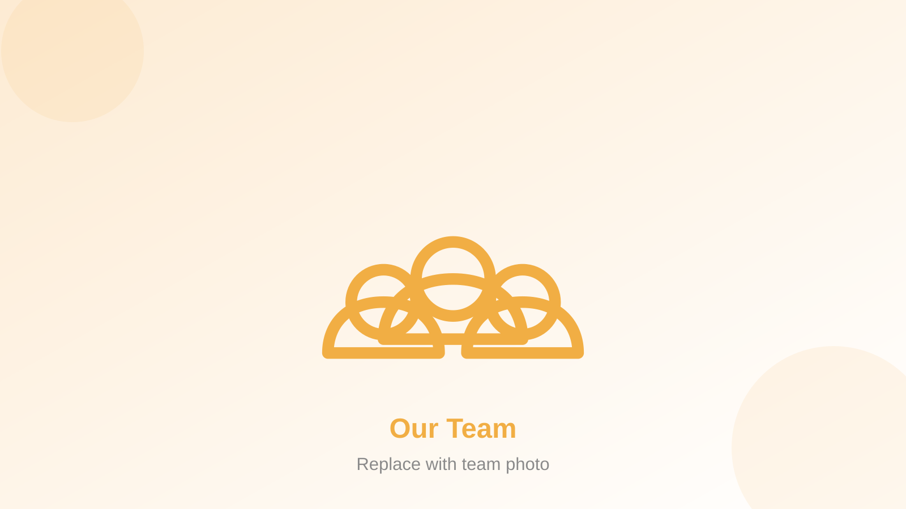

# Sadbhaav Child Development Foundation — Static Site (v1)

A hand-coded, dependency-free recreation of `sadbhaav.mindrops.com` in plain
HTML5, CSS3 and vanilla JavaScript (no frameworks, no build step). Built from
your uploaded homepage HTML export plus the Home/About screenshots.

## What's included in this pass

| Page | Status |
|---|---|
| `index.html` (Home) | Fully built from your 7 screenshots: hero slider, "Every Child Counts" checklist, quote banner, "Create future with us" centre badges, 15-card services grid, events + testimonials, reel quote block, volunteer CTA, footer. |
| `about.html` | Fully built from your 7 screenshots: page banner, foundation intro, "Our Journey" timeline, Mission/Vision, "What We Do", Directors (click a card to highlight it, like the site), services grid, team grid. |
| `services.html`, `events.html`, `gallery.html`, `csr-partnerships.html`, `contact.html`, `donate.html` | **Placeholder pages** so navigation and the footer never 404. They reuse real copy where we already have it (e.g. every service name, the 3 event cards, the address/email/phone), but are marked for expansion once you share screenshots for those pages. |

Send the remaining screenshots whenever you're ready and I'll flesh those six
pages out to the same fidelity as Home/About.

## Structure

```
site/
├── index.html
├── about.html
├── services.html / events.html / gallery.html / csr-partnerships.html / contact.html / donate.html
├── css/
│   └── styles.css        — one shared stylesheet (variables, layout, components, responsive)
├── js/
│   └── script.js         — mobile menu, hero slider, testimonial/team sliders, director card
│                            selection, active-nav-link highlighting, top-bar hide-on-scroll
└── assets/
    ├── images/           — logo + all photo/badge/avatar placeholders (SVG)
    └── icons/sprite.svg  — reference copy of the icon set inlined at the top of every page
```

Every page inlines the same `<svg style="display:none">` icon sprite and the
same header/footer markup (there's no server-side templating in a static
vanilla site, so this is copy-pasted intentionally — keep it in sync if you
hand-edit one page).

## About the images

Your uploaded HTML/screenshots point at photos hosted on the live WordPress
site, which this sandbox can't fetch. Every photo, avatar and badge is
currently a lightweight **generated SVG placeholder** (soft gradient + icon +
label) sized to match the original layout exactly, so swapping in the real
files is a one-line change:

```html

<!-- becomes -->

```

Just drop your real JPG/PNG files into `assets/images/` with matching names
(or update the `src` paths) — no CSS changes needed, since all image
containers are sized responsively, not to a fixed placeholder aspect ratio.

## Colors & type (sampled from your screenshots)

- Navy (headings): `#2c3374`
- Footer navy: `#0a1245`
- Orange (buttons/accents): `#f1ae44`
- Body gray: `#6b6b6b`
- Section gray background: `#f2f2f4`
- Headings: Poppins (Google Fonts) · Body: Open Sans (Google Fonts)

## Running it

No build step — just open `index.html` in a browser, or serve the folder
with any static server, e.g.:

```
python3 -m http.server 8000
```

## Known simplifications to revisit

- The "Our Journey" timeline is rebuilt as a scrollable HTML/CSS timeline
  (numbered steps) rather than the original single infographic image, since
  the exact years in your screenshot were too small to read reliably.
- The Directors "click to highlight" behaviour and the Team grid mirror the
  interaction implied by your screenshots (an active/highlighted card,
  dot-style pagination) using real vanilla JS — wire in more team members by
  duplicating a `.person-card` block.
- Contact form and Donate page are structured but not wired to a backend or
  payment gateway (none was provided) — the form shows a confirmation note
  instead of actually sending mail.
